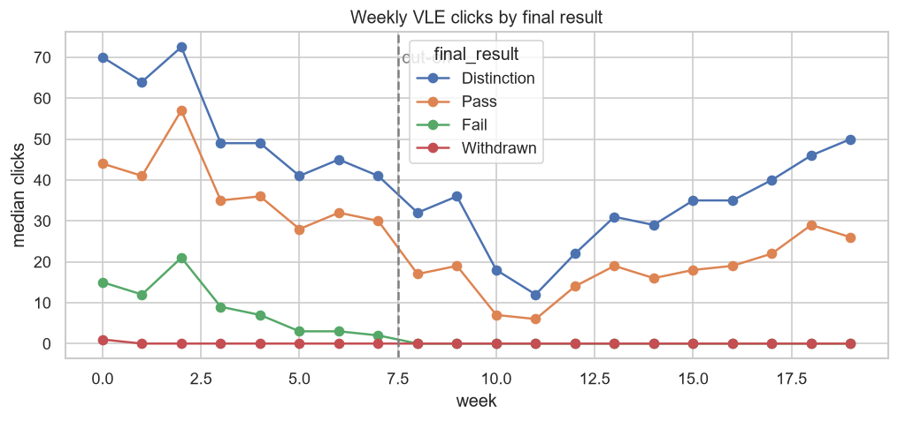
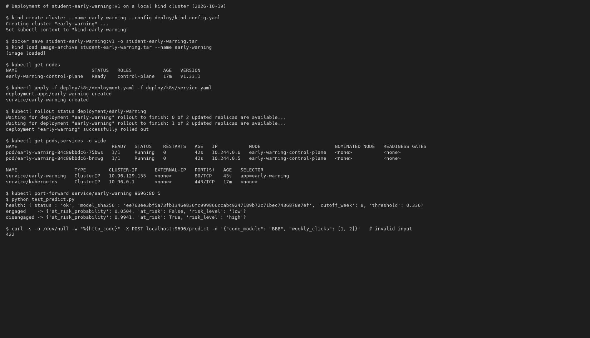

# Student Early-Warning System

Predict, **after the first 8 weeks of a course**, which students are likely to **fail or withdraw**, so that
tutors can reach out while there is still time to help.

Midterm project for [Machine Learning Zoomcamp 2026](https://github.com/DataTalksClub/machine-learning-zoomcamp).
Versión en español: [README.es.md](README.es.md).

## Problem

In online and distance courses a large share of students never finish: in the dataset used here, **53%** of
enrolments end in *Fail* or *Withdrawn*. Tutors have limited time, and by the time a student misses the final
exam it is too late. The useful question is:

> *With what we know at week 8 — who the student is, how they use the virtual campus, and how they did in the
> first assessments — how likely are they to fail or drop out?*

**How the model is used:** every week (from week 8 on) the course platform sends each active student's summary
to the API. The tutor gets the list sorted by risk and contacts the top of it (a message, a call, an extra
tutoring session). The model ranks students; the tutor decides.

## Data

[Open University Learning Analytics Dataset (OULAD)](https://analyse.kmi.open.ac.uk/open_dataset) —
Kuzilek, Hlosta & Zdrahal (2017), *Scientific Data* 4, 170171. License: CC BY 4.0.

- 32,593 enrolments of 28,785 students in 7 modules and 4 presentations (2013B, 2013J, 2014B, 2014J)
- demographics, registration dates, **10.6M daily click records** in the virtual learning environment (VLE),
  assessment submissions and scores, and the final result (*Distinction, Pass, Fail, Withdrawn*)

`prepare_data.py` downloads the original zip from the UCI repository and aggregates the click log into
weekly totals. The resulting compact files are committed in `data/`, so the notebook and training script run
without downloading the 450 MB raw log:

| File | Content |
|---|---|
| `data/students.csv` | one row per enrolment: demographics, registration, final result, clicks and active days for weeks 0-19 |
| `data/assessments.csv` | assessment schedule (non-exam) per module presentation |
| `data/student_assessments.csv` | submissions: day submitted, score |

## Approach

**Target:** `at_risk = 1` if the final result is *Fail* or *Withdrawn*.
Students who had already unregistered before week 8 are excluded (there is nothing left to predict).

**Features** (`features.py`, shared by training and the API):

| Group | Features |
|---|---|
| Demographics | module, gender, region, highest education, deprivation band (IMD), age band, disability, previous attempts, credits |
| Registration | days between registration and course start |
| VLE activity (weeks 0-7) | total clicks, clicks in the first and last 2 weeks, clicks before the start, active days, active weeks, weeks since last activity, activity trend |
| Assessments | due, submitted, missed, late submissions, mean and min score |

**Validation — temporal split.** The model will be used on *future* presentations, so we never mix
presentations between train and test:

| Split | Presentations | Students |
|---|---|---|
| train | 2013B, 2013J | 11,434 |
| validation | 2014B | 6,217 |
| test | 2014J | 8,881 |

**Models** (ROC AUC on validation, after tuning):

| Model | Tuned parameters | Validation AUC |
|---|---|---|
| **Logistic regression** (scaled) | C | **0.826** |
| XGBoost | eta, max_depth, min_child_weight, rounds | 0.825 |
| Random forest | n_estimators, max_depth, min_samples_leaf | 0.817 |
| Decision tree | max_depth, min_samples_leaf | 0.801 |

Logistic regression and XGBoost are tied, so the final model is **logistic regression**: simpler, faster and
easier to explain to tutors. It is retrained on train + validation.

## Results

- **Test AUC (2014J, future presentation): 0.803** · F1 at threshold 0.336: 0.671
- Contacting the top 20% of students by predicted risk: precision 0.92, recall 0.40 (validation)
- How early: AUC 0.71 at week 1, 0.79 at week 4, 0.83 at week 8, 0.85 at week 12
- Strongest signals: assessment scores and recent, regular activity on the virtual campus

See [`notebook.ipynb`](notebook.ipynb) for the EDA, feature importance, tuning and all the plots.



## Project structure

```
├── README.md / README.es.md
├── notebook.ipynb          # EDA, feature importance, model selection and tuning
├── prepare_data.py         # download OULAD + aggregate the click log into data/*.csv
├── features.py             # feature engineering shared by training and serving
├── train.py                # trains the final model -> models/model.bin + metadata.json
├── predict.py              # FastAPI service (GET /health, POST /predict)
├── test_predict.py         # example requests
├── tests/                  # unit tests for the feature engineering
├── data/                   # compact dataset (committed)
├── models/                 # trained model (committed)
├── Dockerfile
├── deploy/                 # kind cluster config and Kubernetes manifests
├── fly.toml                # optional Fly.io deployment
├── pyproject.toml / uv.lock
└── images/
```

## How to run

### 1. Environment

The project uses [uv](https://docs.astral.sh/uv/) and Python 3.11.

```bash
pip install uv          # or: curl -LsSf https://astral.sh/uv/install.sh | sh
uv sync                 # creates .venv with the exact versions from uv.lock
                        # (the Docker image installs only the serving dependencies: --no-dev)
source .venv/bin/activate   # Windows: .venv\Scripts\activate  (or prefix commands with `uv run`)
```

### 2. Data (optional)

`data/` is already in the repository. To rebuild it from the original source:

```bash
uv run python prepare_data.py
```

### 3. Notebook and training

```bash
uv run jupyter notebook notebook.ipynb
uv run python train.py      # writes models/model.bin and models/metadata.json
uv run pytest               # unit tests
```

### 4. Run the API locally

```bash
uv run uvicorn predict:app --host 0.0.0.0 --port 9696
```

Interactive docs at <http://localhost:9696/docs>. In another terminal:

```bash
uv run python test_predict.py
```

or with curl:

```bash
curl -X POST http://localhost:9696/predict -H "Content-Type: application/json" -d '{
  "code_module": "BBB", "gender": "F", "region": "London Region",
  "highest_education": "Lower Than A Level", "imd_band": "0-10%", "age_band": "0-35",
  "disability": "N", "num_of_prev_attempts": 1, "studied_credits": 120,
  "date_registration": -45, "clicks_before_start": 0,
  "weekly_clicks": [40, 15, 5, 0, 0, 3, 0, 0],
  "weekly_active_days": [2, 1, 1, 0, 0, 1, 0, 0],
  "assessments_due": 2, "assessment_scores": [], "late_submissions": 0
}'
```

Response:

```json
{"at_risk_probability": 0.9941, "at_risk": true, "risk_level": "high"}
```

`risk_level`: *high* (probability ≥ 0.75), *medium* (≥ decision threshold 0.336, chosen by maximizing F1
on validation), *low* otherwise.

### 5. Docker

```bash
docker build -t student-early-warning:v1 .
docker run --rm -p 9696:9696 student-early-warning:v1
uv run python test_predict.py
```

### 6. Deployment

**Kubernetes (local, with [kind](https://kind.sigs.k8s.io/))**

```bash
kind create cluster --name early-warning --config deploy/kind-config.yaml
kind load docker-image student-early-warning:v1 --name early-warning
# if this is slow or hangs on Docker Desktop, load it from a file instead:
#   docker save student-early-warning:v1 -o image.tar && kind load image-archive image.tar --name early-warning
kubectl apply -f deploy/k8s/
kubectl rollout status deployment/early-warning
kubectl port-forward service/early-warning 9696:80
uv run python test_predict.py
kind delete cluster --name early-warning
```

`deploy/kind-config.yaml` raises the control-plane start-up timeout to 10 minutes (the default 4 minutes can be too
short with Docker Desktop on Windows). The Deployment runs 2 replicas with readiness and liveness probes on `/health`.

Evidence of the deployment on kind (2 replicas, predictions through the Service, invalid input rejected with 422):



Plain-text log: [`images/kind_deployment.txt`](images/kind_deployment.txt).

**Cloud ([Fly.io](https://fly.io)) — optional, not deployed**

`fly.toml` is ready for a cloud deployment with the same Docker image (it needs a Fly.io account):

```bash
fly auth login
fly launch --copy-config --no-deploy   # pick a unique app name if "student-early-warning" is taken
fly deploy
uv run python test_predict.py https://<your-app>.fly.dev
```

## Limitations

- One institution (UK Open University, distance learning, 2013-2014). The model must be re-validated before
  being used in another context.
- Demographic features carry some signal; any real use should check that the alerts are fair across groups and
  that they lead to *support*, never to penalties.
- The model ranks students to help tutors prioritize; it does not replace their judgement.

## Acknowledgements

Dataset: Kuzilek J., Hlosta M., Zdrahal Z. *Open University Learning Analytics dataset.* Sci. Data 4:170171 (2017).
Course: [DataTalksClub ML Zoomcamp](https://github.com/DataTalksClub/machine-learning-zoomcamp).
